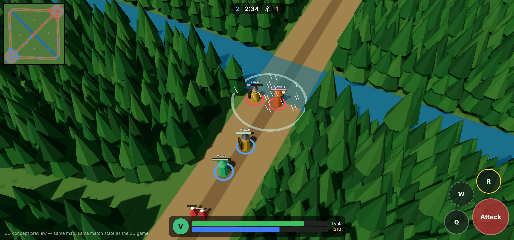
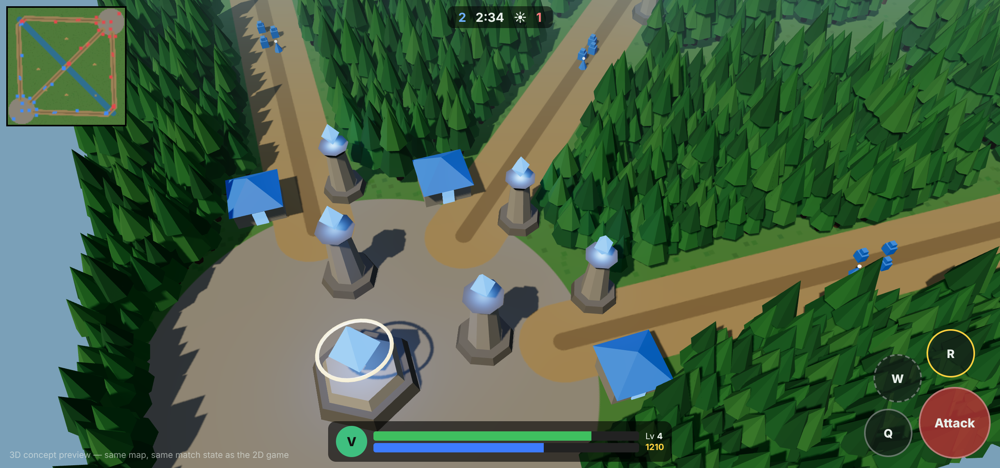

# Going 3D: plan

> **Status: first playable 3D view is in** (`src/client/renderer3d.ts`, models in `src/client/three/`). It is the default view; Settings → Graphics switches back to the lighter 2D view. Next: test on phones (frame rate, battery), then animations and real art.

### What the first 3D version does

- Terrain with real height (base plateaus, ward hills) and the forest as instanced 3D trees that darken in fog of war.
- Low-poly placeholder models for all 6 heroes (same as the concept viewer), lane creeps, jungle monsters, the Warden, every building, wards, power-ups and projectiles. Each model is merged into 1-3 meshes to keep draw calls low.
- Ground effects (aim arrows, spell areas, rings, pings) come from the 2D renderer, drawn into a texture laid on the terrain; fog of war is a second texture over the whole map.
- Health bars, names, damage numbers and the minimap are drawn on top in screen space. Taps are turned into ground points with a ray against the terrain.
- Day/night dims the light. If WebGL is unavailable the game falls back to 2D.

*Concept renders made with Three.js from the real map and a real match state (bots at 2:34). The 3D look is a placeholder, not final art.*

## What changes, and what doesn't

The game is split into two halves:

| Part | Folder | In 3D |
|---|---|---|
| **Simulation**: rules, map, combat, abilities, items, fog, bots | `src/sim` | **Unchanged.** It already works in meters on a ground plane: world `(x, y)` becomes 3D `(x, 0, y)`. |
| **Client**: drawing, input, HUD | `src/client` | `renderer.ts` (Canvas 2D) is replaced by a Three.js renderer. HUD, menus, shop and touch controls stay as they are (HTML over the canvas). Input only changes how a screen tap becomes a ground point (a ray against the ground plane instead of a 2D transform). |

So everything we build and test in 2D (rules, balance, bots, UI) carries over to 3D as-is.

## How the 3D version would be built

- **Engine:** Three.js in the same web app, so we keep one codebase and one Capacitor build for iOS/Android. Babylon.js is the alternative if we want its built-in tooling.
- **Camera:** classic MOBA angle (about 55° tilt, 38° field of view) following your hero. Pinch to zoom, and the minimap still moves it.
- **Art:** low-poly, stylized and readable on a phone (bright team colors, clear silhouettes). Models in glTF format, made by an artist or bought as asset packs (with licenses that allow commercial games), with simple animations: idle, run, attack, cast, death.
- **Performance budget (mid-range phone, 60 fps):**
  - Trees are drawn as one instanced batch (thousands of trees for a handful of draw calls).
  - Units share materials; under about 150 draw calls per frame.
  - One shadow-casting light around the camera.
  - Fog of war is a darkening layer on the ground texture, like now.
- **Effects:** spell effects as particles and decals (Arrow Storm, Cataclysm, Fireball trail). Health bars as small camera-facing sprites.
- **Effort:** a playable 3D client (placeholder models, same gameplay) is about 1–2 milestones. The art and animation pass is the larger part and can run alongside.

## Workflow

1. `main` = the stable 2D game.
2. All features, fixes and tuning continue in 2D on the working branch through a pull request. Every push redeploys the test build to https://itsmoemousavi.github.io/game/ for phone testing. When a batch is good, it is merged into `main`.
3. Once gameplay is settled, a separate `3d` branch replaces only the renderer. The 2D renderer can stay as a "low graphics" option for weak phones.
4. Ship the Capacitor app with the 3D renderer.
